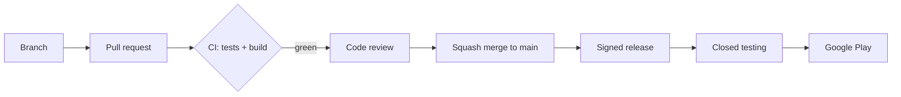

# SG Tecnologia e Automações

**Software for money and time.** Personal finance apps and automations, built mobile-first and privacy-first. 
**Software para dinheiro e tempo.** Apps de finanças pessoais e automações, feitos para o celular e com privacidade em primeiro lugar.

---

## 🇺🇸 English

### Products

**Finora** · personal finance for Android, iPhone next.
Shows at a glance how much is still safe to spend this month, and logs an expense in three taps.
Your data stays on your phone: no account, no server, no internet permission.
`Closed testing on Google Play`

### How we build

| | |
|---|---|
| **Privacy by design** | Data lives on the device. Nothing leaves it unless the person asks for it. |
| **Money is exact** | Amounts are stored in cents, never floating point, and every calculation rule has a test. |
| **One codebase, two platforms** | Kotlin Multiplatform and Flutter: one codebase ships to Android and iOS. We pick the stack per product (Finora runs on Kotlin Multiplatform and Compose). |
| **Nothing ships unreviewed** | Every change is a pull request, reviewed by the other engineer, with a green CI run. |
| **Small, safe releases** | Signed builds, shrunk with R8, rolled out through closed testing before production. |

### Contact

Security issues: read our [security policy](https://github.com/sg-tecnologia-automacoes/.github/blob/main/SECURITY.md) and do not open a public issue. 
Everything else: [@joshsegatt](https://github.com/joshsegatt) · [@goncalvesdev](https://github.com/goncalvesdev)

---

## 🇧🇷 Português

### Produtos

**Finora** · finanças pessoais para Android, iPhone em seguida.
Mostra num olhar quanto ainda dá para gastar no mês e lança um gasto em três toques.
Seus dados ficam no celular: sem conta, sem servidor, sem permissão de internet.
`Em teste fechado no Google Play`

### Como construímos

| | |
|---|---|
| **Privacidade desde o projeto** | Os dados ficam no aparelho. Nada sai dele sem a pessoa pedir. |
| **Dinheiro é exato** | Valores guardados em centavos, nunca em ponto flutuante, e toda regra de cálculo tem teste. |
| **Um código, dois sistemas** | Kotlin Multiplatform e Flutter: um código só vai para Android e iOS. A tecnologia é escolhida por produto (o Finora usa Kotlin Multiplatform e Compose). |
| **Nada entra sem revisão** | Toda mudança é um pull request, revisado pelo outro engenheiro e com CI verde. |
| **Lançamentos pequenos e seguros** | Builds assinados, otimizados com R8 e liberados primeiro em teste fechado. |

### Contato

Segurança: leia a [política de segurança](https://github.com/sg-tecnologia-automacoes/.github/blob/main/SECURITY.md) e não abra issue pública. 
Outros assuntos: [@joshsegatt](https://github.com/joshsegatt) · [@goncalvesdev](https://github.com/goncalvesdev)
